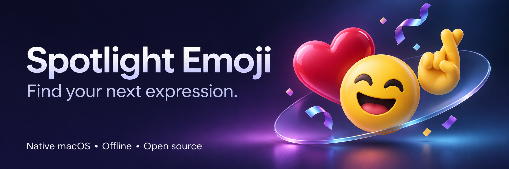
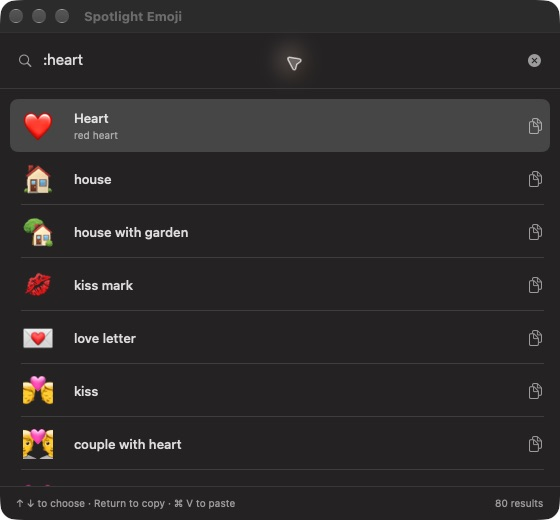

<p align="center">
  
</p>

<div align="center">

# Spotlight Emoji

**Find an emoji where you already search.**

Native emoji search for macOS Spotlight, with a small SwiftUI picker when you want one.

[](https://www.apple.com/macos/)
[](https://developer.apple.com/swift/)
[](LICENSE)

</div>

<p align="center">
  
  <br>
  <sub>The native macOS picker, captured from the running app. The banner above is promotional artwork.</sub>
</p>

> **Spotlight activation status:** Enter-to-copy works in the app picker. An intermittent failure when opening results from macOS Spotlight is under investigation; the latest build includes continuation handling and installation registration fixes, pending desktop confirmation.

## Search. Select. Copy.

1. Open Spotlight with **⌘ Space**.
2. Type **fingers crossed**, **pray**, **heart**, or another emoji name.
3. Select the emoji result and press **Return** to copy it.
4. Paste with **⌘ V**.

| Search | Match |
| :--- | :---: |
| `fingers crossed` | 🤞 |
| `pray` | 🙏 |
| `heart`, `:heart:` or `hjerte` | ❤️ |
| `thumbs up` | 👍 |
| `lol` | 😂 |

Spotlight may label the result action **Open**. The helper handles that native selection by copying the emoji.

## What you get

- **Native Spotlight results.** Emoji appear alongside your existing results, with emoji thumbnails and names.
- **3,963 emoji.** Unicode emoji sequences, including skin tones, flags, and combined emoji.
- **English and Norwegian search.** CLDR keywords plus familiar aliases such as “fingers crossed” and “pray.”
- **A native picker.** Open Spotlight Emoji itself to search, navigate with **↑ / ↓**, and press **Return** to copy. Copy buttons and double-click work too.
- **Works offline.** The emoji catalog is bundled. No accounts, runtime network requests, or analytics.

Shortcode aliases such as `:heart`, `:heart:` and `:thumbs_up:` are included in the Spotlight index and supported in the native picker. The colon is a search alias, not a system-wide mode switch: Spotlight does not expose a public API for an app to claim all `:` queries.

Spotlight controls the order of mixed results. The app supplies ranking hints, but cannot guarantee an emoji will outrank a website, message, or app. Use Spotlight’s **Spotlight Emoji** filter when you want only emoji results.

## Install from source

Requires **macOS 26 or later** and **Xcode 26 or later** with the macOS SDK selected. The current build has been tested with Xcode 27.2.

```sh
git clone https://github.com/mathiash98/spotlight-emoji.git
cd spotlight-emoji
./scripts/install.sh
```

The script builds and locally signs the app, runs its search checks, installs it in `~/Applications`, and opens it. On first launch, allow a short time for Spotlight to index the catalog. Quit an older running copy before installing an update.

There is no notarized download yet; build locally with Xcode.

## How it works

A **Core Spotlight** index contains the emoji names, keywords, and thumbnails. **App Intents** describe the emoji entities and copy actions. Native Spotlight selections are handled through both the open intent and the application’s user-activity callback.

The app writes to the clipboard only when you select a copy action. It does not read your existing clipboard, and it does not change Spotlight’s keyboard shortcut or install a File Provider.

Source lives in [`SpotlightEmoji/EmojiApp.swift`](SpotlightEmoji/EmojiApp.swift). No third-party runtime dependencies.

## Develop and check

```sh
xcodebuild -project SpotlightEmoji.xcodeproj \
  -scheme SpotlightEmoji -configuration Release \
  -derivedDataPath /tmp/spotlight-emoji-build -jobs 2 build

"/tmp/spotlight-emoji-build/Build/Products/Release/Spotlight Emoji.app/Contents/MacOS/Spotlight Emoji" --check-search
```

The checks cover common English/Norwegian queries, preferred matches, empty results, and unique emoji identifiers. The native search window supports keyboard testing; Spotlight ranking and result activation must also be checked on a real desktop.

If emoji stop appearing, quit the helper, reset its catalog marker, and open it again:

```sh
defaults delete no.mathias.SpotlightEmoji catalogVersion
open "$HOME/Applications/Spotlight Emoji.app"
```

## License and data

Code: [MIT](LICENSE). Emoji names, sequences, and keyword data: [Unicode License](UNICODE-LICENSE.txt). See [data sources](DATA-SOURCES.md).

## Inspiration

[Spotmoji](https://github.com/omarshahine/spotmoji) demonstrates the native Core Spotlight approach and searchable shortcode metadata.
